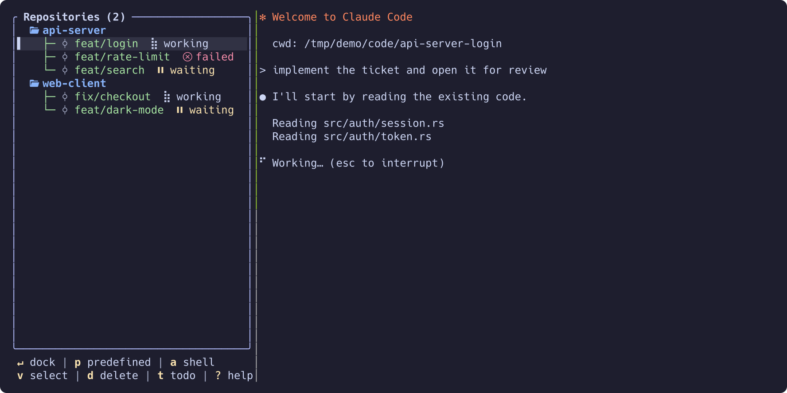
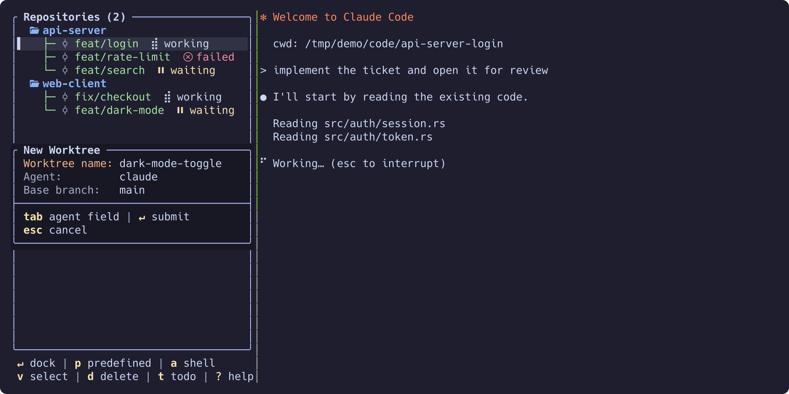
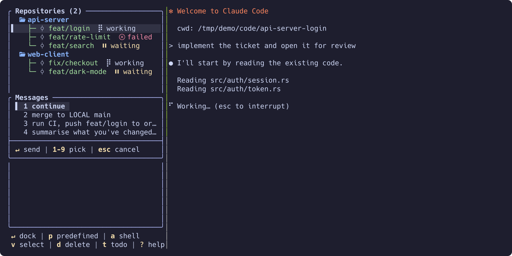

# Wingmux

A tmux-native control centre for coding agents (Claude Code, Codex, Mistral
Vibe, …) running **in parallel across repositories and git worktrees**. See
every agent's state at a glance, jump into one with a keystroke, create and
tear down worktrees instantly.



## Why

- Five agents on five branches means losing track of which one wants you.
  Wingmux shows `working`, `waiting`, `blocked` (needs a permission answer)
  and `failed` per agent, live.
- One keystroke creates a git worktree, cuts a branch and starts your agent
  in it. One more removes it again.
- The agent pane is a **real tmux pane** docked beside the tree, not a
  re-rendering: scrollback, copy mode, image paste and the agent's own keys
  all work untouched.
- Your tmux session stays clean: agent shells live in their own sessions
  until you dock one.

## Install

```sh
brew install ike-forge/tap/wingmux       # macOS or Linux
```

or from source (Rust 1.97):

```sh
cargo install --git https://github.com/ike-forge/wingmux
```

Requires `git` and `tmux` ≥ 3.0 (developed against 3.7b). Linux and macOS.
Every release also installs a short alias, `wing`.

## Quick start

```sh
cd ~/work          # a repository, or a folder of repositories
wingmux
```

Run it in a tmux pane, or from a bare shell — it starts a tmux session for
itself. Then:

1. `n` — name a new worktree; Wingmux cuts the branch and starts the agent.

   
2. `j` / `k` — move; the agent's pane docks beside the tree as you land on it.
3. `Enter` — type into the agent. Get back with your tmux binding
   (`<prefix> + ←` by default).
4. `p` — send a canned prompt ("continue", "run CI and push …").

   
5. `d` — delete the worktree when its work is merged.

Press `?` for every key.

## Concepts

```
RepositoryA  (a git repo found in the current folder)
  ├── master        (the main checkout — untouched)
  ├── worktreeA1    (git worktree + 1..n shells)
  └── worktreeA2
RepositoryB
  └── worktreeB1
```

- **Repository**: an existing local git repo. Imported and removed only;
  never created or deleted by Wingmux.
- **Worktree**: a git worktree created for you, with a shell running your
  agent.
- **Shell**: a tmux window in the worktree — an agent, or any long-running
  command.

Non-goals: no orchestration, no MCP/skill management, no web UI, no
merge/PR automation. Only worktree teardown is automated.

## Keys

| Key | Action |
|-----|--------|
| `j` / `k`, `g` / `G` | move, first / last |
| `h` / `l` | collapse / expand |
| `Enter` | put the cursor in the docked agent pane |
| `n` | new worktree |
| `a` | add a shell to a worktree |
| `p` | send a predefined message |
| `t` / `T` | repository / global todo pad |
| `d` | delete worktree or close shell |
| `r` / `R` | refresh / reset layout |
| `f` | fetch the repository's upstream (`↑ahead ↓behind` on its row) |
| `ctrl-g` | lazygit popup on the selected repository or worktree |
| `ctrl-t` | switch theme |
| `?` | help |
| `q` | quit |

Mouse works too: click selects, double-click opens, the wheel scrolls the
preview. All keys, in full: [`docs/usage.md`](docs/usage.md).

## Configuration

First run writes a fully commented `$XDG_CONFIG_HOME/wingmux/config.toml`
with every setting at its default. A few you may want:

```toml
theme = "catppuccin-mocha"   # ctrl-t switches live
lazygit = "lazygit"          # ctrl-g command
poll_interval_ms = 500

[defaults]
agent = "claude"             # what new worktrees start

[icons]
preset = "unicode"           # no Nerd Font? "nerdfont" is the default

[[messages]]                 # the `p` modal
text = "merge to LOCAL <base_branch>"
```

A repository can commit a `.wingmux.toml` so teammates are configured on
clone. Layering, failure behaviour and every key:
[`docs/configuration.md`](docs/configuration.md).

## More

- [Usage](docs/usage.md) — every key and action
- [Configuration](docs/configuration.md) — layering, agents, messages
- [Repository discovery](docs/discovery.md) — which repos are listed
- [Themes](docs/theming.md) — seven built-ins, custom themes
- [Layout and icons](docs/ui.md) — what each glyph means
- [Agent status](docs/agent-status.md) — how states are detected, hooks
- [How it works with tmux](docs/how-it-works.md)
- [Architecture](docs/architecture.md) — design decisions
- [Shortcuts](docs/shortcuts.md) — the rule behind each binding

## Development

```sh
mise install       # toolchain
mise run gate      # fmt + clippy + tests (needs tmux)
mise tasks         # everything else
```

Logs: `$XDG_STATE_HOME/wingmux/wingmux.log` (stdout belongs to the TUI).
See [`AGENTS.md`](AGENTS.md) for contributor conventions.

## License

[0BSD](LICENSE)
