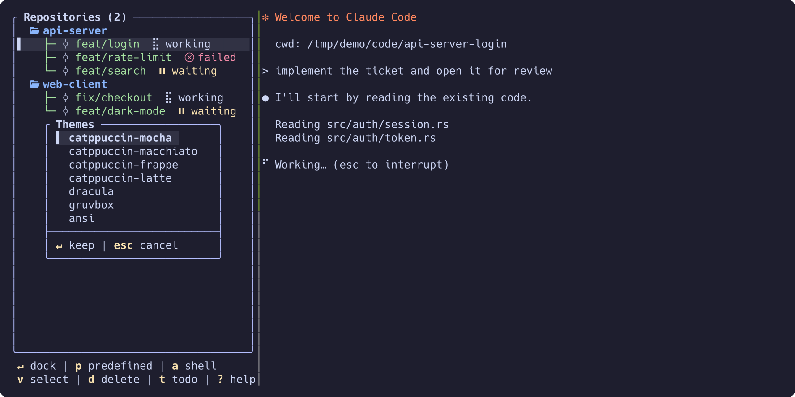

# Themes

`$XDG_CONFIG_HOME/wingmux/themes/<name>.toml`. Colours are named roles
(`background`, `accent`, `tree_repository`, `status_waiting`, …) written as
`#rrggbb` hex, an ANSI-16 name (`cyan`, `bright_black`, `gray`, …), or
`default` (terminal default). Seven built-ins ship with the binary:

- **catppuccin-mocha** (default) — dark, highest contrast; the reference set
- **catppuccin-macchiato** — dark, middle contrast
- **catppuccin-frappe** — dark, warm, lowest contrast
- **catppuccin-latte** — the light theme
- **dracula** — truecolor; falls back to the nearest xterm-256 colour (cube or
  grey ramp) on terminals without 24-bit colour (`COLORTERM` when it is set,
  otherwise the terminal's own identity — `TERM`, `TERM_PROGRAM`, `VTE_VERSION`
  or a marker such as `WT_SESSION`)
- **gruvbox** — truecolor with the same fallback
- **ansi** — ANSI-16 palette only, so it inherits your terminal's colours

The Catppuccin flavours use the official hex values, unmodified, mapped onto
the app's roles (`base` → background, `text`/`subtext0` → text/dim,
`surface0-2` → selection/borders, flavour accents for status, `peach` for the
accent on the dark flavours and `lavender` on latte — `lavender` sits too
close to `text` on a dark background for a one-character key to stand out).

Press **`ctrl-t`** inside the TUI for a live theme picker: move with
`j`/`k` (or `PgUp`/`PgDn`, `Home`/`End`) and the whole screen repaints with
the new palette; `Enter` keeps the previewed theme, `Esc` restores the one
you opened with. The pick is written to the `theme = ...` line of
`~/.config/wingmux/config.toml`, leaving the rest of the file as it was.
A repository `.wingmux.toml` or `--config` that sets `theme` still wins.

`NO_COLOR` (present and non-empty) switches to a monochrome render — every
role resolves to the terminal default; the UI stays readable because meaning
is carried by symbols, labels and position, not by colour.

**A theme answers for the states you act on; the rest borrow.** The shipped
themes set four status colours — the ones a row's hue has to tell apart at
a glance — and leave the other three to a base role, so no theme can drift
away from what a state means:

| Role | Shipped value | Why |
|---|---|---|
| `status_waiting` | yellow | the agent finished its turn and is parked |
| `status_blocked` | orange / peach | the same "wants you" family as waiting, but its own hue: blocked owes you an answer *now* |
| `status_failed` | red | something went wrong |
| `status_ended` | purple / mauve | the agent is gone and a plain shell is left — not a state you act on, and not ordinary text either |

| Role | Borrows | Why |
|---|---|---|
| `status_working` | `foreground` | an agent doing its job is not an alarm — the spinner already says it is running |
| `status_idle` | `dim` | nothing to act on, so it recedes |
| `status_dead` | `dim` | same, and the whole row is muted anyway |
| `worktree_merged` | `tree_worktree` | the green of the worktree level: a merged worktree is done and safe to delete, and must not read as ordinary text |
| `shortcut` | `accent` | the key in a shortcut hint; the Catppuccin flavours and `dracula` set it to yellow |

Every one of the eight stays optional and overridable: set the key in your
theme and your value wins, omit it and it borrows (`blocked` falls back to
`status_waiting`, `ended` to `foreground`), so a theme file setting all
eight and one setting only two both load unchanged.

**The selected row is tinted, not repainted.** The cursor row takes
`selection_bg` as a background and leaves every foreground alone, because
those foregrounds *are* the information: the status colour, the dimming of a
dead shell, the worktree's state. Inverting them would erase what you
moved the cursor there to read. (`selection_fg` still applies inside modals,
where rows carry no colour of their own.)
